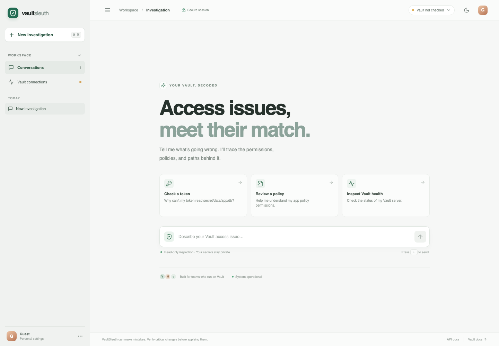
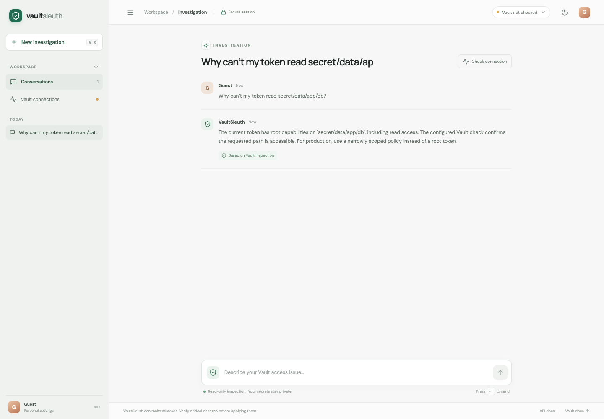
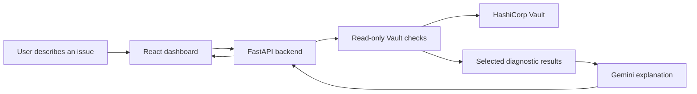

<div align="center">

# 🔎 VaultSleuth

### Diagnose Vault access issues with evidence, not guesswork.

An AI-assisted, read-only diagnostic tool for HashiCorp Vault. Inspect token metadata and path capabilities, then get a clear explanation of what the evidence shows.

<br />

[](https://www.python.org/)
[](https://fastapi.tiangolo.com/)
[](https://react.dev/)
[](https://www.docker.com/)
[](https://www.hashicorp.com/products/vault)
[](https://ai.google.dev/)

<br />

**[Quick start](#-quick-start) · [Features](#-what-it-does) · [Security](#-security--data-flow) · [API](#-api-at-a-glance)**

<br />

VaultSleuth is an independent project. It is not affiliated with, endorsed by, or sponsored by HashiCorp, Inc.

</div>

---

## The problem

A Vault `403 permission denied` response tells you that access was denied, but not why. You may need to check whether the token is valid, what capabilities it has on a path, and whether Vault is healthy—often by switching between several tools.

VaultSleuth brings these read-only checks into one workflow and explains the results in plain language.

## Product preview

<div align="center">



*Start an investigation, choose a suggested check, or describe an access problem.*

<br /><br />



*Review an example diagnosis grounded in Vault check results. The response shown is illustrative.*

</div>

## ✨ What it does

- Checks Vault health, initialization, seal status, and standby status.
- Looks up safe metadata for the token configured on the backend, including policies, TTL, and renewability.
- Checks the token's capabilities on paths mentioned in the user's question.
- Lists policy names when relevant to the request.
- Uses Gemini to explain the collected evidence and suggest next steps.
- Keeps chat history, display name, and theme in the browser's `localStorage`.
- Provides a FastAPI backend with interactive API documentation.

> **How the AI works:** The current version is an AI-assisted diagnostic workflow, not an autonomous tool-calling agent. The backend runs a fixed set of Vault checks, then sends the question and selected results to Gemini for explanation. Gemini does not call Vault, and it never receives the Vault token.

## 🧭 How an investigation works



1. The browser sends the question to the backend.
2. The backend checks Vault health and token metadata, then checks capabilities for paths found in the question.
3. It filters token identifiers and unrelated metadata from the results.
4. The question and selected diagnostic results are sent to Gemini over HTTPS.
5. The browser displays the explanation. Vault configuration is never changed automatically.

## 🔐 Security & data flow

### What stays on the backend

- `VAULT_TOKEN` and `GEMINI_API_KEY` are supplied to the backend through its environment; they are not stored in browser `localStorage` or included in chat prompts.
- The token's raw ID and accessor are filtered out of Gemini context.
- The current diagnostic tools do not read secret payloads or write Vault configuration.
- `.env` is excluded from Git and the Docker build context. Keep real credentials out of commits.

### What is sent to Gemini

VaultSleuth sends the user's question and selected diagnostic results—such as requested paths, capabilities, policy names, and limited token metadata—to the configured Gemini API. **This is not a zero-egress or fully on-premises AI design.** Do not send sensitive paths or diagnostic information to an external model unless your organization has approved that data flow. For a fully internal deployment, use an approved private model endpoint or replace the Gemini integration.

### Before an organizational deployment

The included Compose setup is for local development and evaluation, not a hardened multi-user service. Before exposing it to a team or network:

- Replace the development Vault and `dev-token` with the organization's Vault and a narrowly scoped, read-only token.
- Store credentials in an approved secret manager; never commit `.env` or real credentials.
- Add API authentication and authorization, and restrict network access and CORS to approved origins.
- Keep `VAULT_ADDR`, `VAULT_TOKEN`, and `GEMINI_API_KEY` in the backend deployment environment. The API does not provide an endpoint to change backend credentials or Vault targets.
- Terminate TLS at a trusted ingress or reverse proxy.
- Review Gemini data handling, retention, region, and contractual requirements with the security team.

## 🚀 Quick start

### Requirements

- Docker Desktop or Docker Engine with Docker Compose
- A Gemini API key for AI-generated explanations

### 1. Configure the local environment

```bash
cp .env.example .env
```

Add your approved key to `.env` as `GEMINI_API_KEY`. This file is ignored by Git and Docker; do not paste real credentials into source files.

### 2. Start VaultSleuth

```bash
docker compose up --build -d
```

### 3. Open the app

| Service | URL |
|---|---|
| Frontend | [http://localhost:3000](http://localhost:3000) |
| Backend health | [http://localhost:8000/health](http://localhost:8000/health) |
| API documentation | [http://localhost:8000/docs](http://localhost:8000/docs) |
| Development Vault | [http://localhost:8201](http://localhost:8201) |

The published ports bind to `127.0.0.1`. The development Vault uses the disposable root token `dev-token`; it is for local evaluation only. Inside Docker, the backend reaches Vault at `http://vault:8200`—`localhost` inside the backend container refers to that container itself.

Follow backend logs with `docker compose logs -f backend`. Stop the stack with `docker compose down`.

### Run the frontend outside Docker

Start the backend and Vault first, then run:

```bash
cd frontend
npm install
npm run dev
```

Open [http://localhost:5173](http://localhost:5173). In this setup the frontend uses the backend at `http://localhost:8000`.

## 🧩 API at a glance

| Method | Endpoint | Description |
|---|---|---|
| `GET` | `/health` | Backend liveness |
| `GET` | `/api/config` | Reports whether credentials are configured; returns no credential values or Vault address |
| `POST` | `/api/vault/check` | Checks Vault health and configured token validity |
| `POST` | `/api/chat` | Runs an evidence-based diagnosis |

Example:

```bash
curl -X POST http://localhost:8000/api/chat \
  -H 'Content-Type: application/json' \
  -d '{"message":"Why can\u0027t I read secret/data/app/db?"}'
```

## 🛠️ Built with

| Layer | Technologies |
|---|---|
| Backend | Python 3.10+, FastAPI, Uvicorn, Pydantic |
| Vault integration | Requests, HashiCorp Vault HTTP API |
| AI explanation | Google GenAI SDK, Gemini |
| Frontend | React, Vite, Lucide |
| Local services | Docker, Docker Compose |

## 📁 Project layout

```text
.
├── agent.py                 # Diagnostic orchestration and Gemini explanation
├── backend.py               # FastAPI endpoints
├── vault_tools.py           # Read-only Vault API helpers
├── Dockerfile               # Backend image
├── docker-compose.yml       # Local Vault, backend, and frontend services
├── frontend/                # React + Vite dashboard
└── docs/screenshots/        # README product previews
```

## Scope

VaultSleuth is a prototype for local evaluation. It diagnoses the token configured for the backend; it does not inspect another developer's token by accessor. It explains access evidence but does not change policies or replace Vault's audit trail, security review, or operational tooling.

## License

No license has been added yet. All rights are reserved unless a license is added to this repository.
