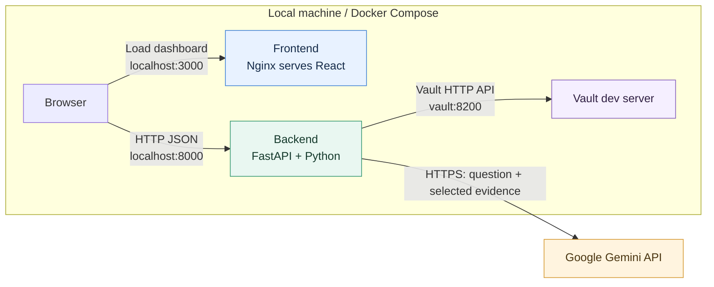
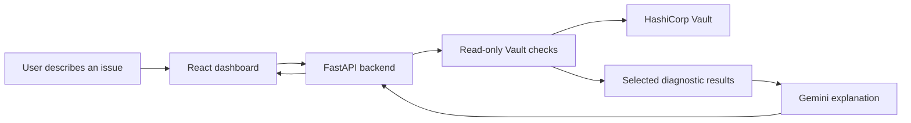

<div align="center">

# 🔎 VaultSleuth

### Diagnose Vault access issues with evidence, not guesswork.

An AI-assisted, read-only diagnostic tool for HashiCorp Vault. Inspect token metadata and path capabilities, then get a clear explanation of what the evidence shows.

<br />

[](https://www.python.org/)
[](https://fastapi.tiangolo.com/)
[](https://react.dev/)
[](https://www.docker.com/)
[](https://www.hashicorp.com/products/vault)
[](https://ai.google.dev/)

<br />

**[Quick start](#-quick-start) · [Architecture](#-architecture) · [Configuration](#️-configuration-reference) · [Security](#-security--data-flow) · [API](#-api-reference)**

<br />

VaultSleuth is an independent project. It is not affiliated with, endorsed by, or sponsored by HashiCorp, Inc.

</div>

---

## The problem

A Vault `403 permission denied` response tells you that access was denied, but not why. You may need to check whether the token is valid, what capabilities it has on a path, and whether Vault is healthy—often by switching between several tools.

VaultSleuth brings these read-only checks into one workflow and explains the results in plain language.

## Product preview

<div align="center">


*Start an investigation, choose a suggested check, or describe an access problem.*

<br /><br />


*Review an example diagnosis grounded in Vault check results. The response shown is illustrative.*

</div>

## ✨ What it does

- Checks Vault health, initialization, seal status, and standby status.
- Looks up safe metadata for the token configured on the backend, including policies, TTL, and renewability.
- Checks the token's capabilities on paths mentioned in the user's question.
- Lists policy names when relevant to the request.
- Uses Gemini to explain the collected evidence and suggest next steps.
- Keeps chat history, display name, and theme in the browser's `localStorage`.
- Provides a FastAPI backend with interactive API documentation.

> **How the AI works:** The current version is an AI-assisted diagnostic workflow, not an autonomous tool-calling agent. The backend runs a fixed set of Vault checks, then sends the question and selected results to Gemini for explanation. Gemini does not call Vault, and it never receives the Vault token.

## 🏗️ Architecture

VaultSleuth runs as three services in Docker Compose. The browser talks to the frontend and API through ports on the host; the backend talks to Vault over Docker's private service network and to Gemini over HTTPS.



### Service responsibilities

| Component | Runs where | Responsibility |
|---|---|---|
| **Frontend** | Nginx container, or Vite dev server | Renders the dashboard, sends chat and Vault-check requests, stores browser preferences and chat history in `localStorage`. |
| **Backend API** | Python container, or local Python process | Validates API input, reads credentials from its environment, coordinates Vault checks, filters selected results, and calls Gemini. |
| **Vault** | Local development container, or an operator-managed Vault | Answers health, token lookup, policy-name, and capability requests. The diagnostic helpers use read-only API operations. |
| **Gemini** | Google API over HTTPS | Converts the user's question and selected diagnostic evidence into a human-readable explanation. It does not connect to Vault. |

### Network addresses and ports

| Caller | Destination | Why it is different |
|---|---|---|
| Browser on the host | `http://localhost:3000` | Published frontend port; Nginx serves the production build. |
| Browser on the host | `http://localhost:8000` | Published backend port used by the frontend JavaScript. |
| Browser on the host | `http://localhost:8201` | Published development Vault port, configurable with `VAULT_DEV_PORT`. |
| Backend container | `http://vault:8200` | Compose DNS name and container port. Container `localhost` would refer to the backend itself. |

Compose publishes these ports on `127.0.0.1`, so the development services are intended to be reachable from the local machine. The Vault process listens on `0.0.0.0` **inside its container** so the backend container can reach it; its host port is still loopback-bound.

## 🧭 Request and diagnosis flow



1. The browser sends `POST /api/chat` with a natural-language `message`. The request does not include a Vault address or token.
2. The backend checks Vault health and looks up the token configured for the backend.
3. It extracts up to five Vault-like paths from the question and checks the configured token's capabilities for each path. If the question mentions policies, it also requests policy names.
4. It selects a small set of token fields and health fields for the model context. The raw token ID and accessor are not included.
5. The backend sends the question and selected diagnostic context to Gemini over HTTPS.
6. Gemini returns an explanation. The backend sends that answer to the browser; it does not persist the conversation.

If the question does not contain a recognizable Vault path, the workflow can still check health and token metadata, but it will not have path-capability evidence to explain.

## 🧩 API reference

The API is designed for the included single-user local frontend. It has no built-in user authentication.

| Method | Endpoint | Request | Purpose |
|---|---|---|---|
| `GET` | `/health` | None | Liveness check for the backend process. It does not prove Vault or Gemini connectivity. |
| `GET` | `/api/config` | None | Returns boolean credential-configured flags only; no address or credential values. |
| `POST` | `/api/vault/check` | Empty body | Checks Vault health and the backend-configured token. |
| `POST` | `/api/chat` | `{"message":"..."}` | Runs the fixed diagnostic workflow and asks Gemini to explain the evidence. |

### Chat request example

```bash
curl -X POST http://127.0.0.1:8000/api/chat \
  -H 'Content-Type: application/json' \
  -d '{"message":"Why can\u0027t I read secret/data/app/db?"}'
```

Successful response:

```json
{
  "answer": "The configured token has ..."
}
```

The message must contain 1–8,000 characters and cannot be blank. The API returns a validation error for an invalid request, `503` for a missing or failed Gemini configuration, and `502` if Gemini returns no text. Vault diagnostic errors are summarized rather than returning raw Vault response bodies.

## ⚙️ Configuration reference

Docker Compose reads `.env` from the project directory. Start from the example:

```bash
cp .env.example .env
```

Then open `.env` in a text editor and set the Gemini key. Do not commit this file.

| Variable | Used by | Default / example | Description |
|---|---|---|---|
| `GEMINI_API_KEY` | Backend | Empty in `.env.example` | Google Gemini API credential. Required for AI-generated answers. |
| `VAULT_TOKEN` | Backend | `dev-token` in local Compose | Token the backend uses for Vault checks. Use a narrowly scoped read-only token outside local dev. |
| `VAULT_DEV_PORT` | Compose | `8201` | Host port mapped to the local Vault container's port `8200`. |
| `VAULTSLEUTH_ALLOWED_ORIGINS` | Backend | Local frontend origins | Comma-separated CORS origins accepted by the API. Avoid `*` for deployments. |
| `VAULT_ADDR` | Backend | `http://vault:8200` in Compose | Vault API address as seen from the backend process. In Compose, use the service name `vault`; from a host-run backend, use the mapped host address. |
| `VAULTSLEUTH_ALLOW_PRIVATE_VAULT` | Backend | `true` in Compose | Allows the backend operator to configure a non-local Vault address. It is not set by an API request. |

### Running the backend outside Docker

The backend process does not automatically load `.env`. Export the values in the shell that launches it. When Vault is still running in Compose, use its **host** port from the host-run backend:

```bash
export GEMINI_API_KEY="your-approved-key"
export VAULT_TOKEN="dev-token"
export VAULT_ADDR="http://127.0.0.1:8201"
python -m venv .venv
source .venv/bin/activate
python -m pip install --upgrade pip
python -m pip install -e .
uvicorn backend:app --reload --host 127.0.0.1 --port 8000
```

To run the frontend in development mode in another terminal:

```bash
cd frontend
npm install
npm run dev
```

The Vite page is available at [http://localhost:5173](http://localhost:5173). The included CORS defaults allow this origin. Keep the host-run backend bound to loopback for local use.

## 🔐 Security, privacy & data flow

### What stays on the backend

- `VAULT_TOKEN` and `GEMINI_API_KEY` are supplied to the backend through its environment; they are not stored in browser `localStorage` or included in chat request bodies.
- The token's raw ID and accessor are filtered out of Gemini context.
- The current diagnostic tools do not read secret payloads or write Vault configuration.
- `.env` is excluded from Git and the Docker build context. Keep real credentials out of commits and screenshots.
- The backend does not store chat history. The browser stores conversation content, display name, and theme in `localStorage` on that device. Anyone with access to the browser profile may be able to view this local data.
- API errors and backend logs are designed not to include raw token values, raw Vault error bodies, or the full chat prompt.

### What is sent to Gemini

VaultSleuth sends the user's question and selected diagnostic results—such as requested paths, capabilities, policy names, health status, and limited token metadata—to the configured Gemini API. **This is not a zero-egress or fully on-premises AI design.** Do not send sensitive paths or diagnostic information to an external model unless your organization has approved that data flow. For a fully internal deployment, use an approved private model endpoint or replace the Gemini integration.

### Before an organizational deployment

The included Compose setup is for local development and evaluation, not a hardened multi-user service. Before exposing it to a team or network:

- Replace the development Vault and `dev-token` with the organization's Vault and a narrowly scoped, read-only token.
- Store credentials in an approved secret manager; never commit `.env` or real credentials.
- Add API authentication and authorization, and restrict network access and CORS to approved origins.
- Keep `VAULT_ADDR`, `VAULT_TOKEN`, and `GEMINI_API_KEY` in the backend deployment environment. The API does not provide an endpoint to change backend credentials or Vault targets.
- Terminate TLS at a trusted ingress or reverse proxy.
- Review Gemini data handling, retention, region, and contractual requirements with the security team.

## 🚀 Quick start with Docker Compose

### Requirements

- Docker Desktop or Docker Engine with Docker Compose
- A Gemini API key for AI-generated explanations

### 1. Configure the local environment

```bash
cp .env.example .env
```

Add your approved key to `.env` as `GEMINI_API_KEY`. This file is ignored by Git and Docker; do not paste real credentials into source files.

### 2. Start the services

```bash
docker compose up --build -d
```

### 3. Open the app

| Service | URL |
|---|---|
| Frontend | [http://localhost:3000](http://localhost:3000) |
| Backend health | [http://localhost:8000/health](http://localhost:8000/health) |
| API documentation | [http://localhost:8000/docs](http://localhost:8000/docs) |
| Development Vault | [http://localhost:8201](http://localhost:8201) |

The published ports bind to `127.0.0.1`. The development Vault uses the disposable root token `dev-token`; it is for local evaluation only. Inside Docker, the backend reaches Vault at `http://vault:8200`—`localhost` inside the backend container refers to that container itself. The local dev Vault is in-memory and disposable; recreating its container can reset its state.

Follow backend logs with `docker compose logs -f backend`. Stop the stack with `docker compose down`.

### Run only the frontend outside Docker

Start the backend and Vault first, then run:

```bash
cd frontend
npm install
VITE_API_BASE=http://localhost:8000 \
npm run dev
```

Open [http://localhost:5173](http://localhost:5173). The `VITE_API_BASE` setting tells the browser app to send API requests to `http://localhost:8000`; Vite does not proxy API requests in this project. The backend's default CORS list includes the Vite origin.

## 🛠️ Technology and infrastructure

| Layer | Technologies |
|---|---|
| Layer | Technology | What it provides |
|---|---|---|
| Runtime | Python 3.10+ | Backend language and diagnostic orchestration. The backend Docker image uses Python 3.12. |
| HTTP API | FastAPI, Uvicorn, Pydantic | Request validation, JSON endpoints, API docs, and the ASGI server. |
| Vault access | Requests and Vault HTTP API | Read-only health, token lookup, capability, and policy-name requests. |
| Model integration | Google GenAI SDK and Gemini | Natural-language explanation of selected diagnostic evidence. |
| User interface | React, Vite, Lucide | Chat-style dashboard, connection status, theme, and local preferences. |
| Web serving | Nginx | Serves the built React assets in the frontend container. |
| Local orchestration | Docker Compose | Starts the development Vault, backend API, and frontend together. |

### Container build notes

- `Dockerfile` builds the Python API image and installs the backend runtime dependencies.
- `frontend/Dockerfile` builds the Vite assets in a Node stage, then copies the static output into an Nginx image.
- `docker-compose.yml` wires the services together and publishes their host ports on loopback.
- `.dockerignore` keeps local credentials and development artifacts out of the Docker build context.
- `.gitignore` excludes `.env`, virtual environments, Node dependencies, and build output from Git.

The Compose stack is a convenience for local development. It does not provide multi-user authentication, production secrets management, TLS termination, durable Vault storage, or an enterprise network policy.

## 📁 Project layout

```text
.
├── agent.py                 # Diagnostic orchestration and Gemini explanation
├── backend.py               # FastAPI endpoints
├── vault_tools.py           # Read-only Vault API helpers
├── Dockerfile               # Backend image
├── docker-compose.yml       # Local Vault, backend, and frontend services
├── frontend/                # React + Vite dashboard
└── docs/screenshots/        # README product previews
```

### Where to look in the source

- `backend.py` defines the HTTP endpoints, request validation, CORS policy, and Vault health-check response.
- `agent.py` coordinates the fixed checks, selects the diagnostic context, and sends it to Gemini.
- `vault_tools.py` contains the HTTP helpers that call Vault. The token is attached only as an `X-Vault-Token` header on backend-to-Vault requests.
- `frontend/src/main.jsx` contains the browser app, chat history persistence, API calls, and personal settings.
- `frontend/src/style.css` contains dashboard styling and responsive layouts.

## Scope

VaultSleuth is a prototype for local evaluation. It diagnoses the token configured for the backend; it does not inspect another developer's token by accessor. It explains access evidence but does not change policies or replace Vault's audit trail, security review, or operational tooling.

The current workflow does not fetch policy HCL or automatically compare an application's required operations against a full policy document. It reports the evidence collected by the implemented checks and can suggest next steps for an operator to verify.

## 🧯 Troubleshooting

| Symptom | Likely cause | What to check |
|---|---|---|
| Frontend says the backend is offline | Backend container is stopped or its port is unavailable | Run `docker compose ps` and `docker compose logs backend`. Check `http://127.0.0.1:8000/health`. |
| `/health` works but Vault check fails | Backend cannot reach Vault, or the configured token is rejected | Check `VAULT_ADDR` from the backend's point of view. In Compose it should be `http://vault:8200`, not `localhost` or the host-mapped port. |
| Chat returns a configuration error | `GEMINI_API_KEY` is empty, invalid, or unavailable | Check that it is set in the backend environment; do not paste it into chat or source files. |
| Browser reports a CORS error in Vite mode | The dev origin is not in the backend allowlist | Add the exact frontend origin to `VAULTSLEUTH_ALLOWED_ORIGINS`, then restart the backend. |
| Host port is already in use | Another process owns 3000, 8000, or 8201 | Stop the conflicting process or change the host-side port mapping in Compose. |
| Vault state disappeared after a rebuild | The local development Vault is disposable and in-memory | Reinitialize/reseed it for local evaluation. Do not use this development server for persistent data. |

Useful commands:

```bash
docker compose ps
docker compose logs -f backend
docker compose logs -f vault
docker compose down
```

## License

No license has been added yet. All rights are reserved unless a license is added to this repository.
